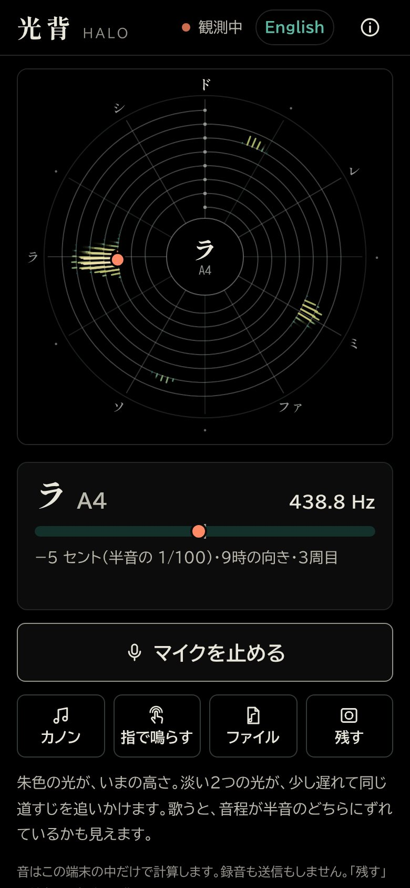
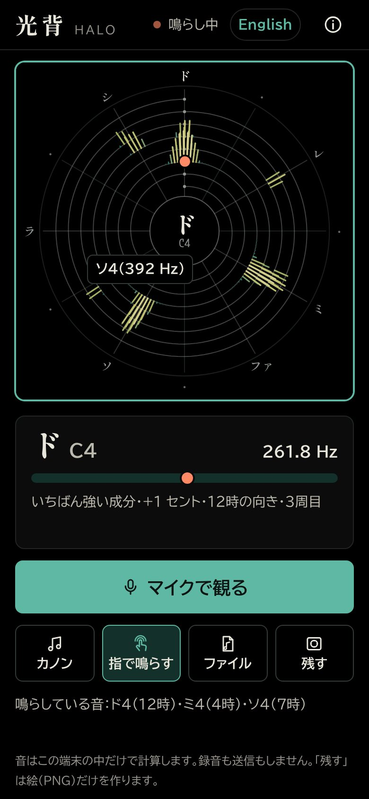
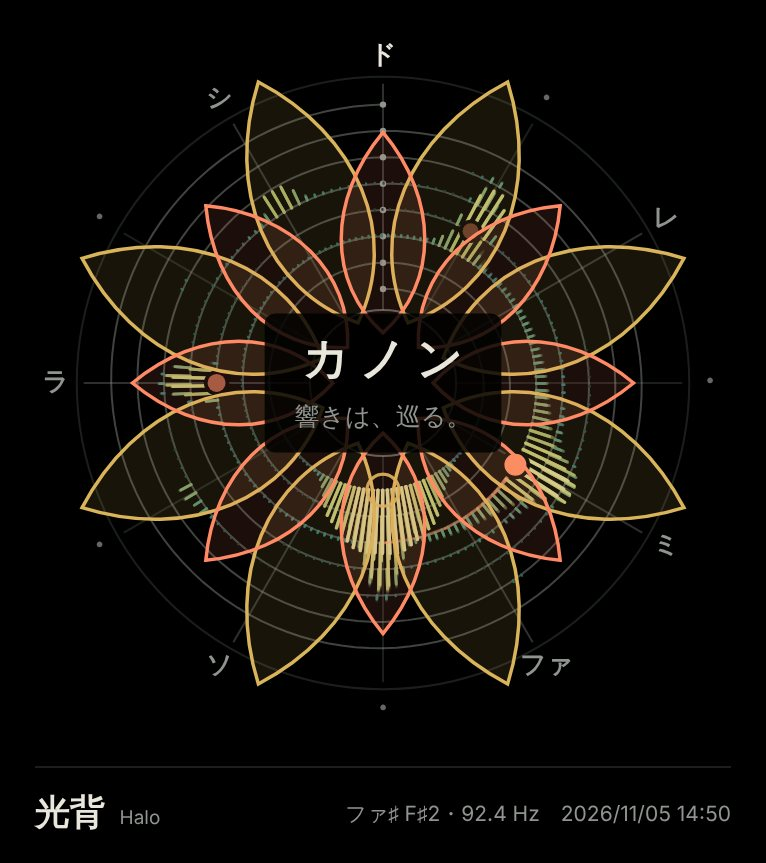
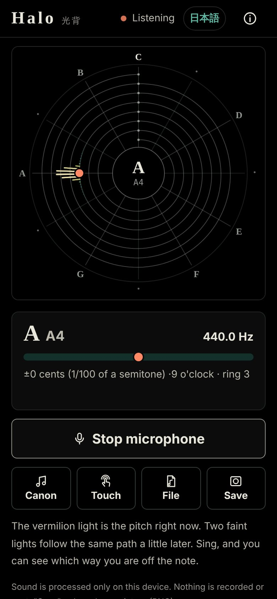
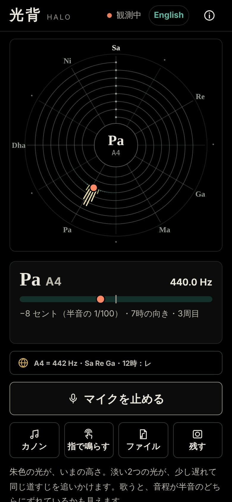
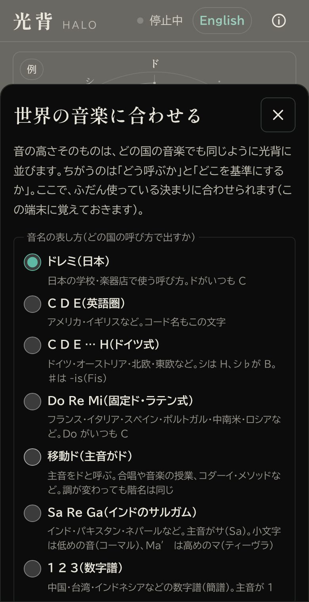

# 光背 Halo — 音の高さを、光の輪で観る

[English](#english) ・ [デモの開き方](#使い方) ・ [ライセンス](#ライセンス)

**光背 Halo** は、マイクで拾った音の高さを「光の輪」に並べて表示する Web アプリです。インストールや会員登録は不要で、スマートフォンのブラウザでそのまま動きます。

仏像の後ろにある光の輪を「光背（こうはい）」、英語で halo（ヘイロー）と呼びます。このアプリでは、その光の輪の上に音の高さを並べます。

| マイクで歌った音（ラ A4） | 指で和音（ドミソ）を鳴らす | 保存した画像 | 英語版 |
| --- | --- | --- | --- |
|  |  |  |  |

| 世界の音楽に合わせる（基準 442 Hz・サルガム・主音レ） | 設定の画面 |
| --- | --- |
|  |  |

## 特長

- **時計の文字盤と同じ配置**：12時がド（C）、時計回りに半音ずつ進みます。12の音名が12の時刻にちょうど重なります
- **1周で1オクターブ**：螺旋の内側ほど低く、外側ほど高い音です。1オクターブ違いの同じ音名は同じ方向にそろうため、**和音や倍音が図形として見えます**
- **千本の光**：螺旋から外へ伸びる光の長さと色が、その高さの音の強さを表します
- **まん中の円で操作**：止まっているときは「タップで聴く」（押すとマイクで聴き始める）。聴いているあいだは音名、高さがはっきりしないときは「静か」「高さ不明」などの状態と、音の大きさの輪を出します。もう一度押すと止まります
- **チューナー**：音名・周波数（Hz）・セント（半音の 1/100）を表示します。歌や楽器の音程の確認に使えます
- **世界の音楽に合わせる**：光の輪の下のボタン（地球の印）で、次の4つを選べます（端末に保存）
  - 基準の高さ：ラ（A4）＝ 415〜466 Hz（国際標準 440、多くのオーケストラ 442・443、バロック 415 など）
  - 音名の表し方：ドレミ・C D E・ドイツ式（H）・固定ド（Do Re Mi）・移動ド・インドのサルガム（Sa Re Ga）・数字譜（1 2 3）
  - 主音：選んだ音を12時に置き、螺旋を回します（どの調でも音階が同じ形に見えます）
  - 四分音：半音の半分の音を「ミ−¼」のように呼びます（アラブ・トルコ・ペルシャの音楽向け）
- **最初の3秒の案内**：初めて開いたときに1回だけ、ドから時計回りに光が巡り、「12時がド、1周で1オクターブ」が目でわかります（「i」の見方から、もう一度流せます）
- **マイクを止められたときの手順**：iPhone・Android・パソコン・Firefox ごとに、どこを押せば許可しなおせるかを出します
- **すぐ試せる**：最初の画面の「例 ▶ カノンを聴いてみる」を押すと、そのまま鳴り始めます
- **サンプル：パッヘルベル「カノン ニ長調」**：楽譜から音をその場で合成します（録音ではありません）。低音・第1〜3声を選んで鳴らせるので、3つの声が同じ旋律を2小節ずつ遅れて追いかける「カノン」の構造を、光の動きで確かめられます。3つの声は朱・空色・藤色に色分けされます
- **指で鳴らす**：螺旋に触れると、最も近い半音の音が倍音つきで鳴り、そのまま光の輪に表示されます。複数の指で和音を鳴らせます（最大4音）
  - **鍵盤**：主音から1オクターブの13鍵を、光の輪の下に出せます（指をすべらせると隣の鍵へ。オクターブは −／＋）。キーボードでも弾けます（Tab で鍵へ移り、Enter かスペースを押しているあいだ鳴る）
  - **なめらか**：半音にそろえず、指の位置そのままの高さで鳴らします（ポルタメント）。倍音の光も一緒に滑ります
- **ファイル**：MP3・M4A（AAC）・WAV・OGG・FLAC などの音のファイルを読めます。パソコンでは、ファイルを画面へドラッグしても読めます
- **画像として保存**：表示中の光の輪を、音名と日時入りの PNG 画像として保存・共有できます
- **録画**：光の動きを、最長 30 秒の動画（iPhone は MP4、Android・パソコンは WebM）にして保存・共有できます。カノン・指で鳴らす・ファイルの音は動画に入ります。マイクで聴いているときは、録画のたびに「マイクの音も入れる」か「光の動きだけ」かを選べます（歌や演奏の記録に）
- **すばやい光**：高い音（約 400 Hz より上）の光は、短い時間だけを見るもう1つの観察窓で描くので、以前の4倍速く動きます。低い音は細かい観察窓のまま（和音の形がくっきり）
- **見た目**：光背の下のパレットの印から選べます（端末に保存）
  - 光の色：金・朱・青・紫・虹。虹は音名ごとに色が決まり（12時の主音が赤）、和音が色の組み合わせとして見えます
  - 追いかける光の軌跡：短い（約 0.4 秒）・ふつう（約 1.2 秒）・長い（約 3 秒）
  - 画面の明るさ：そのまま・少し暗く・暗く（保存する絵と動画は暗くなりません）
- **黒い背景**：日本語版・英語版とも、端末の設定にかかわらず黒い背景で表示します（光が金色に輝きます）
- **英語版**：`en.html` は英語表示の版です。画面右上で日本語版と切り替えられます
- **オフライン対応**：ホーム画面に追加でき、一度開けば通信がない場所でも使えます
- **解説つき**：画面右上の「i」から、見方・物理・数学・音楽・英語・コードの解説を読めます

## 使い方

1. 公開されたページ（`index.html`、英語版は `en.html`）をブラウザで開きます
2. 「マイクで観る」を押し、マイクの使用を許可します
3. 声を出したり楽器を鳴らしたりすると、光の輪に高さが表示されます

マイクを使うには、ページが **https** で配信されている必要があります（ブラウザの仕様）。iPhone ではマナーモード（消音スイッチ）のとき、「カノン」と「指で鳴らす」の音が出ないことがあります。

### ホーム画面に追加する

- iPhone：Safari の共有ボタン →「ホーム画面に追加」
- Android：Chrome のメニュー →「ホーム画面に追加」または「アプリをインストール」

## しくみ（概要）

| 分野 | 内容 |
| --- | --- |
| 物理 | 音は空気の振動です。1秒あたりの振動回数が周波数（Hz）で、2倍の周波数は1オクターブ上の同じ音名に聞こえます |
| 数学 | 螺旋上の位置は「周回 ＝ log₂(f ÷ 65.4)」で決まります。整数部分が何周目か、小数部分が方向です。例：ラ 440 Hz は 2.75 周（3周目の9時の方向）。基準を 440 から a Hz に変えると、ずれは 1200 × log₂(a ÷ 440) セント（442 Hz なら約 7.9 セント） |
| 音楽 | カノンは同じ旋律を一定の遅れで重ねる形式です。y(t) ＝ x(t) ＋ x(t − T) ＋ x(t − 2T)（x：旋律、T：遅れ） |
| コード | Web Audio API の AnalyserNode で音を 8,192 個の周波数区分に分け（FFT）、1,000 本の光それぞれが受け持つ区分をあらかじめ表にして、毎秒約60回描画します。高い音は、もう1つの短い観察窓（2,048 区分）で描きます（時間の細かさと高さの細かさは同時に上げられないため、場所ごとに使い分け）。音の高さは YIN 法で求めます |

## プライバシー

- マイクの音は端末内でのみ処理され、送信は行いません
- 画像の保存は、利用者が「残す」を押したときだけ端末内で行います
- 動画は「録画」を押したときだけ端末内で作ります。マイクの音は、録画のときに「マイクの音も入れる」を選んだときだけ動画に入ります
- マイクの自動音量調整・雑音除去は、測定を正確にするためオフにしています
- 外部への通信は、文字（Google Fonts）の読み込みのみです

## 公開のしかた

ビルド不要の静的サイトです。リポジトリのファイルをそのまま配信すれば動作します。

| 方法 | 手順 |
| --- | --- |
| GitHub Pages | Settings → Pages → Source を「GitHub Actions」にし、Actions の「Deploy to GitHub Pages」を実行します |
| その他の静的ホスティング | `index.html`・`en.html`・`manifest*.webmanifest`・`sw.js`・`css/`・`js/`・`icons/` を配置します |

## 開発

Node.js 20 以上が必要です（依存パッケージなし）。

```bash
npm test
```

```bash
npm run serve
```

| コマンド | 内容 |
| --- | --- |
| `npm test` | 単体テスト（螺旋の計算、楽譜と旋律の判定、音の高さの判定、世界の音名と基準の高さ、オフライン処理、ページ内の数値と実装の一致） |
| `npm run check` | 全ファイルの構文と、オフライン用ファイル一覧（`sw.js`）の点検 |
| `npm run serve` | ローカルサーバー（http://localhost:8080/）。このパソコンの中からだけ開けます。隠しファイル（`.git` など）は返しません |
| `npm run e2e` | ブラウザ（Chromium）による画面の通しテスト。Playwright が必要です |
| `npm run build:artifact` | 1ファイル版（`dist/halo-artifact.html`）の生成 |
| `npm run icons` | アイコンの再生成（`tools/icon.mjs`） |

同じ Wi-Fi のスマホから開いて試したいときだけ、`HOST=0.0.0.0 npm run serve` で起動します（そのあいだは、同じネットワークのだれでも開けます。使い終わったら止めてください。マイクは https でないと使えないため、スマホではマイク以外の確認向けです）。

画面テストを実行するには、先に Playwright を入れます。

```bash
npm i --no-save playwright && npx playwright install chromium
```

### ファイル構成

```
index.html            日本語版の画面（解説を含む）
en.html               英語版の画面
manifest*.webmanifest ホーム画面に追加するための設定
sw.js                 オフライン対応（Service Worker）
css/halo.css          スタイル（色と文字の設定は先頭の :root）
js/main.js            画面の制御（入力・指で鳴らす・チューナー・カノン・保存）
js/kouhai-stage.js    光の輪の部品（描画・音名・蓮・追いかける光・旋律の判定）
js/kouhai.js          光の輪の描画（螺旋の計算・光・画像の書き出し）
js/canon.js           カノンの楽譜・各声部・旋律の判定
js/synth.js           カノンの音の合成
js/pitch.js           音の高さの決定
js/features.js, classify.js, dsp.js   信号処理（FFT・YIN 法・倍音・音の分類）
js/audio.js           音の入出力（Web Audio API・AudioWorklet・細かい観察窓と速い観察窓）
js/recorder.js        録画（canvas の映像と、スピーカーの音を動画に）
js/i18n.js            日本語・英語の切り替え
js/look.js, look-ui.js  見た目（光の色・軌跡の長さ・明るさ）の決まりと設定の画面
js/tuning.js          世界の音楽に合わせる決まり（基準の高さ・音名の表し方・主音・四分音）
js/tuning-ui.js       その設定の画面
js/ui.js, claude.js, prefs.js, format.js, colormap.js   画面部品・設定・書式・配色
tests/                テスト（tests/e2e は画面の通しテスト）
tools/                開発用ツール（サーバー・点検・アイコン・1ファイル化）
```

## ライセンス

[MIT License](LICENSE)

- 楽曲：ヨハン・パッヘルベル「カノン ニ長調」（パブリックドメイン）。音はアプリ内で楽譜から合成しています
- 文字：Shippori Mincho B1・BIZ UDPGothic・M PLUS 1 Code（Google Fonts、SIL Open Font License）

---

## English

**Halo** is a web app that shows the pitch of sound as a ring of light. No install or sign-up: it runs in a phone's browser. Open `en.html` for the English version. Both versions always use a black background.

- **Laid out like a clock face**: C is at 12 o'clock, and each step clockwise is a semitone, so the twelve note names fall on the twelve hours
- **One octave per turn**: low notes are inside the spiral, high notes outside. Notes an octave apart point the same way, so **chords and harmonics appear as shapes**
- **A thousand rays**: the length and color of each ray shows how strong that pitch is
- **The center is a control**: when stopped it says “Tap to listen”; while listening it shows the note name, or a status (Quiet, No clear pitch…) with a level ring when the pitch is unclear. Tap again to stop
- **Tuner**: note name, frequency (Hz) and cents (1/100 of a semitone)
- **Music around the world** (the globe button under the halo): reference pitch A4 = 415–466 Hz; note names in Japanese kana, English letters, German (H), fixed do, movable do, Indian sargam (Sa Re Ga) or numbered notation (1 2 3); any note as the tonic at 12 o'clock (the spiral turns); and quarter-tone names such as “E−¼” for Arabic, Turkish and Persian music
- **Sample: Pachelbel's Canon in D**, synthesized from the score on the spot. Choose the bass and voices 1–3 to see three voices chase the same melody two bars apart
- **Play by touch**: touch the spiral to play the nearest semitone (with harmonics); up to four fingers for chords. Optional 13-key keyboard under the halo, and a glide mode (portamento) that follows your finger without snapping
- **Fast rays**: high notes (above about 400 Hz) are drawn from a second, short analyser, so they move four times faster; low notes keep the fine analyser for crisp chord shapes
- **Look** (palette button under the halo): light color in gold, vermilion, blue, purple or rainbow (rainbow colors each note name, so chords show as color sets); trail length (0.4 / 1.2 / 3 s); screen brightness (normal / a little darker / darker)
- **3-second intro** on first visit: a light goes round from C clockwise, so “C at 12 o'clock, one octave per turn” is clear at a glance (replay it from “i”)
- **Microphone blocked?** Step-by-step instructions for iPhone, Android, computers and Firefox
- **Record**: save the moving halo as a video of up to 30 s (MP4 on iPhone, WebM elsewhere). Canon, touch and file sound go in; while listening with the microphone you choose each time whether to include it
- **Save as image**, **works offline**, **add to home screen**, and built-in explanations (reading the ring, physics, math, music, code)

The microphone needs the page to be served over **https**. Sound is processed on the device only; nothing is recorded or sent.

Development: Node.js 20+, no dependencies. `npm test` runs the unit tests, `npm run serve` starts a local server (loopback only; hidden files such as `.git` are never served), `npm run e2e` runs browser tests (needs Playwright).

License: [MIT](LICENSE). Music: Johann Pachelbel, Canon in D (public domain), synthesized in the app. Fonts: Google Fonts (SIL Open Font License).
